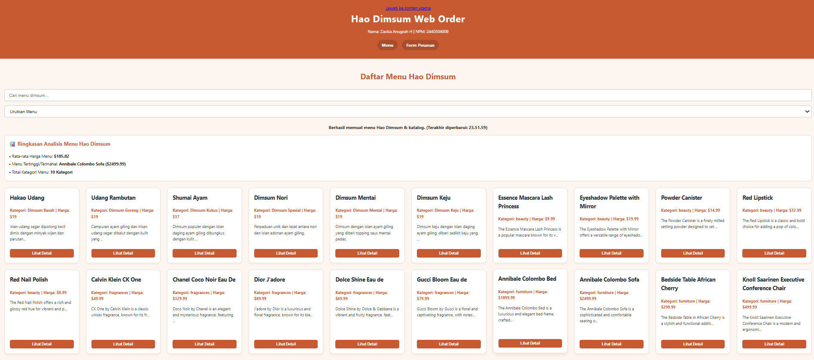
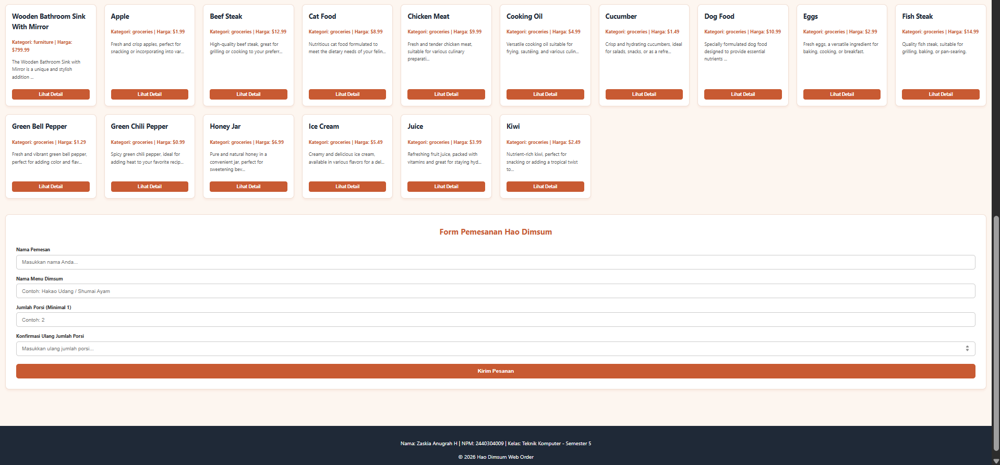
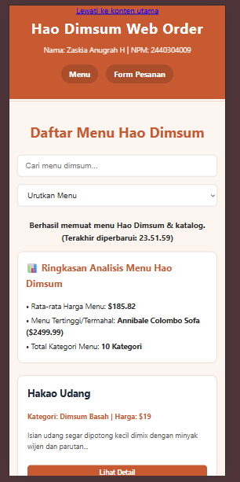
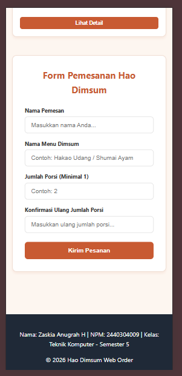

# Hao Dimsum Web Order Dashboard

## 1. Identitas Mahasiswa

| | |
|---|---|
| **Nama** | Zaskia Anugrah Halimatusa'diah |
| **NIM** | 2440304009 |
| **Kelas** | Teknik Komputer - Semester 5 |
| **Repository** | [hao-dimsum-dashboard](https://github.com/kayoo-7z/hao-dimsum-dashboard.git) |

---

## 2. Nama Aplikasi dan Deskripsi Singkat

**Hao Dimsum Web Order Dashboard** adalah aplikasi front-end interaktif untuk katalog menu dan pemesanan online Hao Dimsum lokal Tarakan. Aplikasi ini mengintegrasikan konsumsi REST API publik dengan data lokal, manipulasi DOM dinamis, filter dan pencarian real-time, ringkasan analisis statistik harga, serta validasi form pemesanan client-side yang aksesibel.

---

## 3. Perhitungan Variasi Soal Berdasarkan NIM (2440304009)

Tiga digit terakhir NIM: **X = 0, Y = 0, Z = 9**

| Komponen | Digit | Hasil |
|---|---|---|
| Dataset | X = 0 | Products (Dashboard Produk/UMKM) |
| Fitur Utama | Y = 0 | Search real-time + sorting |
| Form & Validasi | Z = 9 | Dua input yang saling berkaitan harus divalidasi (Jumlah Porsi & Konfirmasi Jumlah Porsi, serta validasi ketersediaan menu) |

**Challenge Individual (C):**

```
S = X + Y + Z = 0 + 0 + 9 = 9
C = S mod 4  = 9 mod 4   = 1
```

**Challenge C = 1:** Tombol *Retry* ketika fetch gagal + waktu terakhir data berhasil dimuat (timestamp).

---

## 4. Dataset dan API yang Digunakan

- **API Eksternal:** DummyJSON Products API
- **Fallback Data Lokal:** File JSON lokal pada `data/products.json` yang memuat katalog menu asli Hao Dimsum Tarakan.

---

## 5. Fitur Utama dan Challenge

1. **Katalog Produk & Menu Lokal:** Menampilkan gabungan produk API dan varian menu asli Hao Dimsum, lengkap dengan tombol detail (modal/alert deskripsi).
2. **Search Real-time & Sorting:** Pencarian instan berdasarkan judul/kategori serta pengurutan berdasarkan nama (A-Z, Z-A) dan harga (termurah/termahal) yang disusun secara vertikal.
3. **Analisis Data Otomatis:** Perhitungan otomatis rata-rata harga menu, menu termahal, dan total kategori menggunakan method array JavaScript (`reduce`, `Set`).
4. **Validasi Form Lanjutan:** Pengecekan nama pemesan (min. 3 karakter), validasi ketersediaan menu di katalog, serta pencocokan jumlah porsi dan konfirmasi porsi.
5. **Challenge C = 1:** Tombol coba lagi (*Retry*) saat pengambilan data gagal dan pencatatan waktu pembaruan data terakhir (*timestamp*).

---

## 6. Cara Menjalankan Project

1. Kloning repository atau letakkan folder `pemweb-pts` ke root web server lokal Laragon:
   `C:\laragon\www\pemweb-pts`
2. Jalankan server Apache pada Laragon.
3. Buka browser (Chrome / Edge / Firefox) dan akses:
   `http://localhost/pemweb-pts/`

---

## 7. Screenshot Desktop dan Mobile

### Tampilan Desktop (>= 1024px)

| Desktop 1 | Desktop 2 |
|---|---|
|  |  |

### Tampilan Mobile (<= 480px)

| Mobile 1 | Mobile 2 |
|---|---|
|  |  |

---

## 8. Endpoint REST API

| | |
|---|---|
| **URL Endpoint** | `https://dummyjson.com/products` |
| **Metode HTTP** | `GET` |
| **Format Respons** | `JSON` |

---

## 9. Jawaban 10 Pertanyaan Penjelasan Kode

### 1. Alur sejak halaman dibuka sampai data tampil

Saat halaman dimuat, fungsi `loadProducts()` dijalankan. Fungsi ini menampilkan status loading (`message.textContent = 'Memuat data...'`), lalu memanggil `fetch(API_URL)` secara asynchronous dengan `await`. Setelah respons HTTP berstatus `ok`, data di-parse menjadi JSON dengan `await response.json()`. Data produk API kemudian digabungkan dengan array menu lokal `haoDimsumMenus` ke variabel `allProducts`. Selanjutnya, fungsi memanggil `renderDataAnalytics()` untuk kalkulasi statistik dan `renderProducts()` untuk mencetak elemen kartu ke dalam DOM.

### 2. Alasan pemeriksaan `response.ok`

`fetch()` hanya melempar error (*rejected*) jika terjadi kegagalan jaringan total (misalnya offline atau DNS error). Jika endpoint mengembalikan status HTTP 404 (Not Found) atau 500 (Server Error), Promise tetap dianggap sukses (*resolved*). Pengecekan `if (!response.ok)` diperlukan agar program dapat mendeteksi kegagalan status HTTP secara eksplisit dan melempar `throw new Error(...)` ke blok `catch`, sehingga pesan kesalahan serta tombol Retry dapat ditampilkan ke pengguna.

### 3. Pengubahan satu data JSON menjadi elemen DOM

Contoh data JSON:

```json
{ "title": "Hakao Udang", "price": 19, "category": "Dimsum Basah", "description": "Isian udang segar..." }
```

Di dalam fungsi `renderProducts()`, method `forEach` membaca setiap objek produk. Elemen kartu dibuat dengan `document.createElement('article')`, judul dengan `<h3>`, informasi harga/kategori dengan `<p>`, deskripsi dengan `<p>`, serta tombol aksi dengan `<button>`. Seluruh elemen disusun ke dalam kartu menggunakan `.append()`, kemudian kartu disematkan ke elemen kontainer `#api-output` pada DOM.

### 4. Penanganan saat internet putus atau error HTTP 404/500

Proses *fetch* dibungkus dalam blok `try...catch`. Jika internet terputus atau respons HTTP gagal, program berpindah ke blok `catch(error)`. Di blok ini, pesan error diubah menjadi informatif (*"Gagal memuat data..."*), data lokal Hao Dimsum ditampilkan sebagai *fallback* agar aplikasi tidak kosong, dan tombol *Coba Lagi (Retry)* dimunculkan ke DOM dengan event listener klik yang menjalankan ulang fungsi `loadProducts()`.

### 5. Cara kerja fitur Y (Search real-time + Sorting)

Dikelola oleh fungsi `handleFilterAndSort()`. Fungsi ini dipicu oleh event `input` pada `#search-input` dan event `change` pada `#sort-select`. Ketika pengguna mengetik atau mengubah urutan, fungsi memfilter array `allProducts` dengan `.filter()` yang mencocokkan kata kunci pada properti `title` atau `category`. Hasil filter diurutkan dengan `.sort()` (memakai `localeCompare()` untuk teks dan pengurangan numerik untuk harga), lalu dikirim ke `renderProducts(filtered)` untuk memperbarui DOM secara instan.

### 6. Cara kerja validasi Z dan alasan input tidak valid ditolak

Validasi form mendengarkan event `submit` dan memanggil `event.preventDefault()` untuk mencegah reload halaman. Input dibaca menggunakan objek `FormData`. Logika memvalidasi:

- nama minimal 3 karakter,
- nama menu yang diketik terdaftar dalam katalog (`allProducts.some(...)`),
- nilai jumlah porsi dan konfirmasi porsi identik (`jumlah === konfirmasiJumlah`).

Input tidak valid tidak boleh langsung diproses untuk mencegah kesalahan pemesanan, menjaga integritas data, menghindari pesanan menu fiktif, dan memberikan umpan balik langsung (*feedback*) kepada pengguna.

### 7. Skenario penerapan localStorage

Aplikasi ini belum wajib memakai `localStorage`, tetapi dapat diterapkan untuk menyimpan riwayat pesanan terakhir pengguna tanpa menambah fitur baru. Ketika form pemesanan sukses dikirim, objek pesanan disimpan dengan `localStorage.setItem('lastOrder', JSON.stringify(pesanan))`. Saat halaman dibuka kembali, program membaca `localStorage.getItem('lastOrder')` untuk mengisi formulir otomatis (*auto-fill*) atau menampilkan riwayat pesanan sebelumnya.

### 8. Fungsi JavaScript penting

```javascript
function handleFilterAndSort() {
    const keyword = searchInput.value.toLowerCase();
    const sortValue = sortSelect.value;
    let filtered = allProducts.filter(item => 
        item.title.toLowerCase().includes(keyword) || 
        item.category.toLowerCase().includes(keyword)
    );
    if (sortValue === 'az') filtered.sort((a, b) => a.title.localeCompare(b.title));
    else if (sortValue === 'za') filtered.sort((a, b) => b.title.localeCompare(a.title));
    else if (sortValue === 'price-low') filtered.sort((a, b) => a.price - b.price);
    else if (sortValue === 'price-high') filtered.sort((a, b) => b.price - a.price);
    renderProducts(filtered);
}
```

- **Input:** String kata kunci dari `#search-input` dan opsi pengurutan dari `#sort-select`.
- **Proses:** Memfilter array `allProducts` berdasarkan kata kunci nama/kategori, lalu mengurutkan array sesuai opsi yang dipilih.
- **Output:** Memanggil `renderProducts(filtered)` untuk memperbarui tampilan kartu menu di DOM.

### 9. Bug/error paling sulit dan solusinya

- **Bug:** Pengecekan nama menu pada validasi form gagal mendeteksi menu jika pengguna mengetik dengan kombinasi huruf besar/kecil berbeda. Selain itu, tata letak form sempat tidak melebar penuh mengikuti kontainer utama.
- **Penyebab:** Perbandingan string bersifat *case-sensitive*, dan terdapat properti `max-width` yang kaku pada pembungkus CSS.
- **Cara menemukan:** Menguji berbagai variasi input teks di browser dan menginspeksi elemen lewat Developer Tools.
- **Solusi:** Menambahkan `.toLowerCase()` pada proses validasi (`p.title.toLowerCase() === namaMenu.toLowerCase()`) dan mengatur lebar kontainer form menjadi `width: 100%`.

### 10. Dua perbaikan teknis jika diberi waktu satu minggu lagi

1. **Debouncing pada kolom pencarian:** Menerapkan debounce pada event `input` agar fungsi filtering tidak dieksekusi pada setiap ketikan, melainkan menunggu jeda beberapa milidetik sehingga performa lebih efisien.
2. **Keranjang belanja berbasis Web Storage:** Mengembangkan fitur keranjang (*cart*) dinamis yang menyimpan daftar pesanan sementara secara persisten di `localStorage`, dilengkapi kalkulasi total pembayaran otomatis.

---

## 10. AI Usage Log

| | |
|---|---|
| **Nama Mahasiswa** | Zaskia Anugrah Halimatusa'diah |
| **NIM** | 2440304009 |
| **Kolaborator** | AI Assistant (Gemini) |
| **Link Sesi Percakapan** | [Transkrip Sesi Kolaborasi AI](#) |

**Ringkasan Penggunaan:**

- Perancangan struktur tata letak HTML5 semantik, CSS responsif bertema Hao Dimsum, dan modularitas JavaScript.
- Implementasi Fetch API dengan `async/await`, penanganan status `response.ok`, dan fallback data lokal.
- Perancangan logika filter pencarian real-time, sorting, dan ringkasan data statistik.
- Penyusunan validasi form interaktif client-side yang mencakup keterkaitan antar-input dan pemeriksaan ketersediaan menu.